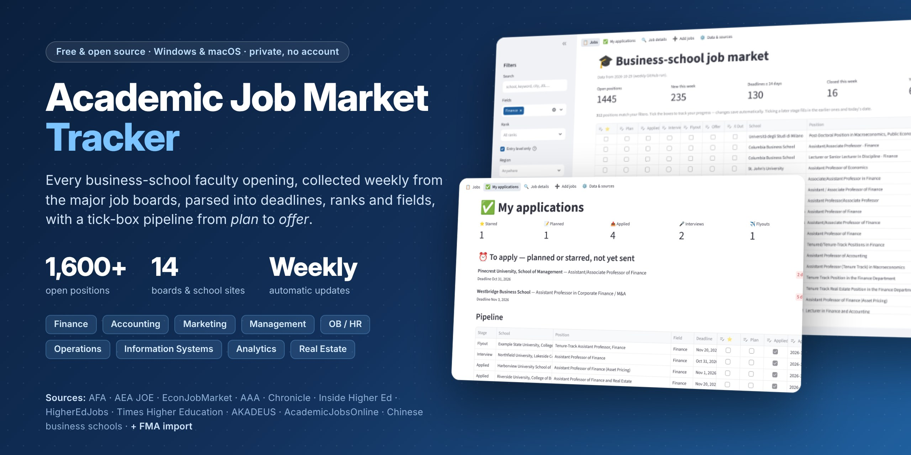
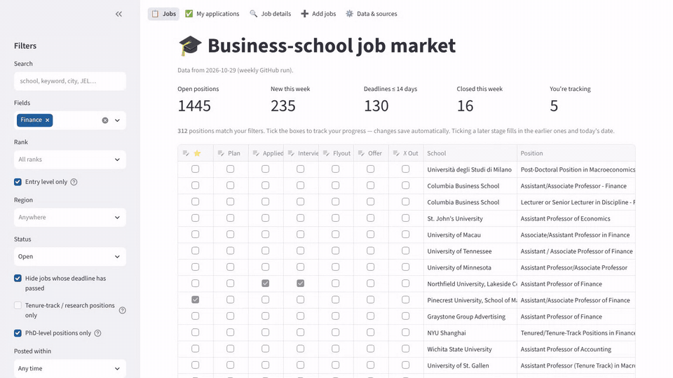
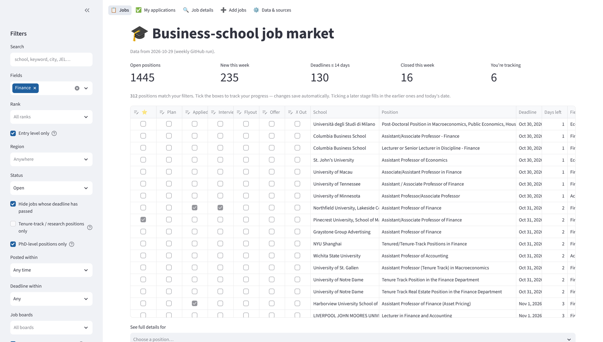
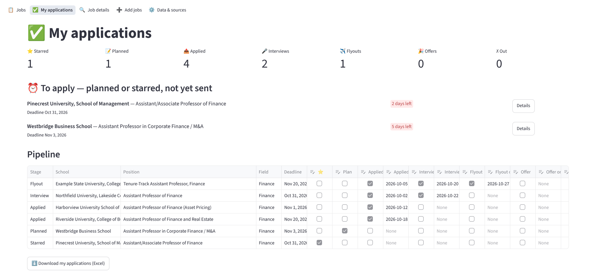
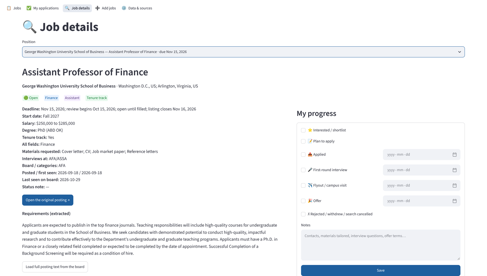

# Academic Job Market Tracker (business schools)



A free, open-source (MIT) tracker for the business-school faculty job market: finance, accounting, marketing, management/strategy,
OB/HR, operations, information systems, analytics, business economics, real estate, insurance and more.

**[⬇️ Download for Windows or Mac](https://github.com/ZoeHu92/Job_Market_Application_Tracker/releases/latest)** ·
[User guide](docs/USER_GUIDE.md) · [Privacy](PRIVACY.md)



* **Every Monday** a GitHub Actions job collects new postings from the job boards listed below and saves them to
  `data/jobs.csv`. It runs on GitHub's servers and costs nothing; the app downloads the new list by itself.
* Each posting is parsed into **school, field, rank, tenure track, degree requirement (PhD / ABD OK), deadline,
  review start date, salary, start date, requested materials, interview venue (FMA, AFA/ASSA, …)** and the key
  requirement sentences. Postings written in Chinese (Chinese university sites) are parsed too.
* The same job posted on several boards is shown once. When a posting disappears from its board (or its page says
  *expired / filled*), it is marked **Closed**.
* A local web app lets you **tick boxes** for ⭐ shortlist → Plan to apply → Applied (date) → Interview → Flyout →
  Offer (or ✗ Out), add notes, and see deadlines coming up.
* A weekly **digest issue** opens on GitHub: new postings by field, deadlines in the next 14 days, and postings
  closed that week. To get it by e-mail, *Watch* this repository (Watch → Custom → Issues).

| Jobs | My applications | Job details |
|---|---|---|
| [](docs/images/jobs.png) | [](docs/images/applications.png) | [](docs/images/details.png) |
| Filter by field, rank, region and deadline; tick to track. | Stage counts, a deadline countdown and your whole pipeline. | Salary, degree, materials and interview venue, read from the ad. |

<sub>Screenshots use demo progress on fictional schools.</sub>

> **Your progress is private.** Ticks, dates, notes and the jobs you add are stored only on your own computer, or
> in a cloud-drive folder you choose. They are never uploaded to GitHub or anywhere else, and every user's
> progress is separate. This repository only holds the code and public job ads. No passwords are needed.
> Details: **[PRIVACY.md](PRIVACY.md)**.

**Guides:** [User guide](docs/USER_GUIDE.md) (install, tracking, weekly routine, FMA import, sync, backups,
troubleshooting) · [Privacy and security](PRIVACY.md)

## Download and start

Get the latest version from the **[Releases page](https://github.com/ZoeHu92/Job_Market_Application_Tracker/releases/latest)**.
It includes its own Python, so nothing else needs to be installed.

| Computer | Download | Start |
|---|---|---|
| Windows | `…-windows-setup.exe` (installer) or `…-windows-x64.zip` (no install) | Run the installer, then use the Start-menu entry; or unzip and double-click **Start Job Tracker.bat**. If Windows says "Windows protected your PC": *More info → Run anyway*. |
| Mac (Apple chip) | `…-macos-apple-silicon.zip` | Unzip and double-click **Start Job Tracker.command**. The first time, macOS blocks it (the app is not signed by Apple): click *Done*, then **System Settings → Privacy & Security → Open Anyway**. On macOS 14 or older: right-click the file → *Open* → *Open*. |
| Mac (Intel) | `…-macos-intel.zip` | Same as above. |

The tracker opens in your browser. Keep the small window that starts with it open while you use it; close it to
quit. To update, install or unzip the newer version; your progress is stored separately and is kept. The app
tells you when a new version is out. Step-by-step help: [User guide → Install and start](docs/USER_GUIDE.md#1-install-and-start).

**From source instead** (for developers): `git clone` this repository, then double-click `start_tracker.command`
(Mac) or `start_tracker.bat` (Windows); they set up Python packages on first run. Or run
`pip install -r requirements.txt` and `python launch.py`.

## Your weekly routine

**Automatic, every Monday** (about 12:17 UTC): GitHub collects new postings from all boards, marks filled or
removed ones as *Closed*, and opens a digest issue that GitHub notifies you about. It runs on GitHub's servers,
so your computer can be off, and it costs nothing. When you next open the app, it downloads the new list.

**Your part, about 10 minutes:**

1. Read the digest, or set the app's sidebar *Posted within* to 7 days.
2. Save FMA's job list page (Ctrl/Cmd+S) and drop it into **Add jobs** (see
   [below](#fma-and-other-member-only-boards-no-password-needed)).
3. Tick ⭐ / *Plan* on the jobs you want and *Applied* once you have applied.
4. Check **My applications → To apply** for upcoming deadlines.

## Use it on several computers

In the app, open **Data & sources → Where your progress is stored**, pick your cloud drive (iCloud Drive,
OneDrive, Dropbox, Google Drive or Nutstore are detected automatically) and click **Use this folder**. Do the same
on every computer: your ticks, dates, notes and added jobs then live in one folder that the cloud drive keeps in
sync. If both computers already had progress, it is merged (the newest change for each job wins).

* **Phone:** the folder also holds `My job applications.xlsx`, refreshed whenever you change something. Open it
  in the cloud-drive app on your phone to check your pipeline (read-only).
* **Saving on two computers at the same moment** can make the cloud drive create a "conflict copy". The app
  notices it and offers a one-click merge.
* The weekly job list is downloaded by each computer itself; only your own progress is synced.

## Keeping the weekly scrape running

The weekly scrape (`.github/workflows/weekly_scrape.yml`) is already active and needs no regular attention:

* It runs only on the repository's **default branch** (Settings → General → Default branch), so keep the workflow
  file there.
* **Check that it ran:** the Monday digest arrives, and the app's Jobs page says *"Data from <date>"*. If a digest
  is missing, open **Actions → Weekly job scrape**: a red ✗ shows what failed, and **Run workflow** retries.
* A board that fails one week keeps all its postings and is retried the next week. If the same board fails
  several weeks in a row, its website has probably changed: open an issue.
* GitHub pauses scheduled workflows in public repositories after 60 days without activity. The weekly data
  commits count as activity; if GitHub ever reports the workflow disabled, click **Enable workflow** in Actions.
* To collect twice a week in peak season, add a second `cron` line, e.g. `- cron: "17 12 * * 4"` (Thursdays).

You can also scrape at any time: **Actions → Weekly job scrape → Run workflow** on GitHub, or **Data & sources →
Run the scraper now** in the app. More: [User guide → section 10](docs/USER_GUIDE.md#10-keeping-the-weekly-scrape-running-repository-owner).

## Job boards

| Board | How it is read | Notes |
|---|---|---|
| AFA career center | official RSS feed + posting pages | all finance postings |
| AEA JOE | official XML export | business-school / business-field listings only |
| EconJobMarket | official JSON feed | business-school / business-field ads only |
| AAA career center | official RSS feed + posting pages | faculty postings (staff jobs dropped) |
| Chronicle of Higher Education | RSS (business & management, "professor") | business-school faculty only |
| Inside Higher Ed | RSS (business & management faculty) | business-school faculty only |
| Times Higher Education unijobs | listing pages (business & economics) | UK, Europe, Asia, Australia |
| AKADEUS | announcement list + posting pages | business-school positions worldwide, mostly Europe, Asia and the Middle East |
| HigherEdJobs | 13 business-faculty category feeds | newest 100 per category |
| AcademicJobsOnline | RSS feed | business-school listings only |
| CES (Chinese Economists Society) | job board pages | positions in China |
| SJTU Antai College of Economics and Management | faculty recruitment page | department notices |
| China Economics Education and Research Network (efnchina.com) | faculty notices list | business/finance notices |
| Tsinghua SEM, PBCSF, SAIF | recruitment pages | tracked as one posting each, flagged 🔄 when the page changes |
| **Saved pages you upload** | app → Add jobs | FMA and other member-only or bot-protected boards |

All boards were checked against the live sites in October 2026 (`verified:` in
[`config/sources.yaml`](config/sources.yaml)). The scraper sends an honest user agent, obeys `robots.txt`
(including crawl delays), waits between requests and never re-fetches a posting it already has.

**Not scraped, by design:** FMA's job board needs a member login. AMA, AOM, INFORMS, AIS, jobs.ac.uk and SSRN
answer automated requests with a bot challenge, and gaoxiaojob.com disallows crawlers in its robots.txt. The
tracker does not log in with your password or try to get around these blocks. Most of their postings also appear
on the boards above; for the rest, use the saved-page import below.

## FMA and other member-only boards (no password needed)

1. Log in to FMA as usual and open the job list (*For Job Seekers → View Positions on the Professional Job
   Board*).
2. Save the page: **Ctrl+S** (Windows) or **Cmd+S** (Mac). In Safari, choose *Format: Page Source*.
3. In the app, open **Add jobs** and drop the saved `.html` file(s) in. Every posting on the page is added and
   parsed. Postings already tracked from another board (for example the same job on AFA) are skipped.

Do this whenever you check FMA, for example once a week. The same works for AMA, AOM, INFORMS, AIS and
jobs.ac.uk. A single posting from a listserv e-mail or a school website can be added by pasting its link or text
on the same page.

### Advanced (optional): read job-alert e-mails automatically

If you would rather not upload pages, the tracker can read job-alert e-mails (FMA, AMA, SSRN, listservs) from one
mailbox folder. Set up job alerts on each site, add a Gmail filter that applies the label `JobAlerts`, create a
Gmail *app password* (Google Account → Security → 2-Step Verification → App passwords), and enter it in the app
under **Data & sources → Advanced**. It is stored only on your computer in `my_data/email.env`. For automatic
weekly reading on GitHub instead, make the repository private and add the secrets `TRACKER_IMAP_USER` and
`TRACKER_IMAP_PASSWORD`. The label, mail server and look-back window are set in `config/settings.yaml` under
`email:`.

## Using the app

| Page | What it is for |
|---|---|
| **Jobs** | All postings, soonest deadline first. Filter in the sidebar by field, rank, region, deadline window, new this week, tenure-track and PhD-level. Tick boxes save immediately. Ticking a later stage fills in the earlier ones and today's date. |
| **My applications** | Counts per stage, a to-apply list with days left (red within 7 days), and your full pipeline with editable dates. Exports to Excel. |
| **Job details** | Everything parsed for one posting, a link to the original, the full text, and a form for your progress and notes. |
| **Add jobs** | Import saved pages from FMA and other member-only boards, or add one posting by pasting its link or text. |
| **Data & sources** | When the data was collected, which boards worked, download / scrape buttons, Excel export, backup / restore and the optional e-mail reader. |

Click **Save as default** in the sidebar to keep your filters (for example, Finance + Entry level). The
[user guide](docs/USER_GUIDE.md) explains every page, the tick boxes and the filters.

## Privacy and security

Full details, including a list of every file and every internet connection: **[PRIVACY.md](PRIVACY.md)**.

* **Your progress is private and separate for every user.** Ticks, dates, notes, added jobs and preferences are
  stored only on your computer: in a release build under `%APPDATA%\AcademicJobTracker` (Windows) or
  `~/Library/Application Support/AcademicJobTracker` (Mac); in a source checkout under `my_data/`, which is
  listed in `.gitignore`. They move only if you pick a cloud-drive folder yourself. Nothing is uploaded to GitHub
  or anywhere else. Someone else using this tracker has their own, separate progress, and nobody (including the
  repository owner) can see yours.
* **What is public:** this repository's code and the weekly list of job postings in `data/` (public job ads,
  without their full text), the weekly digest issues and the Actions logs. None of them contain anything about
  you or your applications.
* **Network access:** the app only listens on your own computer (`localhost`), so other people on the same Wi-Fi
  cannot open it. It contacts GitHub (to download the weekly job list and check for a new version) and, only when
  you click those buttons, job boards or posting links. It has no analytics or usage tracking.
* **Passwords:** none are needed. Member-only boards are imported from pages you save yourself; the saved files
  are read on your computer and not kept. The optional e-mail reader stores a revocable app password in a local
  file on your computer only (never in a synced folder).
* **Backups:** a dated copy of your progress is kept every day (last 60) in the `backups` folder next to it;
  *Data & sources → Back up my statuses* downloads a copy you can keep anywhere.
* While the repository is public, full posting texts are not stored in it (`keep_full_description: false` in
  `config/settings.yaml`); the app shows extracted requirements and fetches the full text on demand.

### How "Closed" is decided

A posting is closed only when its board was read completely in that run and the posting is gone. The scraper
then re-checks the posting's own page: a 404, a redirect, or "expired / filled" text confirms it. If 60 % or more
of a board's postings vanish at once, that is treated as a scraping problem and nothing is closed. Postings whose
deadline passed more than 90 days ago, or that have not been seen anywhere for 4 months, are also closed.
Postings that come back are re-opened.

## Files

```
app.py, launch.py          Streamlit app and its launcher
docs/USER_GUIDE.md         step-by-step user guide
docs/images/               screenshots, banner and demo animation (demo data)
PRIVACY.md                 what is stored where, what is public, what goes over the internet
tracker/                   scraper + parsing + storage (python -m tracker.scrape)
config/sources.yaml        job boards
config/settings.yaml       politeness limits, digest and e-mail options, full-text storage
data/jobs.csv              all postings ever seen (written by the weekly workflow; opens in Excel/Stata)
data/scrape_report.json    per-board results of the last run
data/weekly_digest.md      the digest text
my_data/                   source checkout only: YOUR progress and backups (local, never pushed)
packaging/                 release builds (build.py, Windows installer script, release notes)
```

`data/jobs.csv` loads directly into Stata (`import delimited data/jobs.csv, varnames(1) bindquote(strict)
maxquotedrows(unlimited) encoding(utf-8)`) or pandas.

## Development

```bash
pip install -r requirements.txt pytest
python -m pytest -q
```

The tests run offline against fake boards and a fake mailbox. They cover the parsers (deadlines, salaries,
ranks, fields, degree requirements, Chinese text), every adapter, the merge/close rules, the status rules and an
app smoke test.

## License

The code is released under the [MIT License](LICENSE): use it, change it and share it, keeping the copyright
notice. The job postings in `data/` belong to the employers and job boards that published them; the tracker
stores public listing details only, with links to the original ads.
